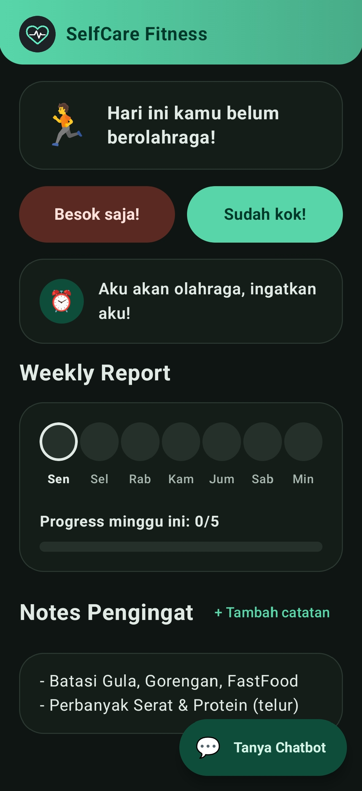
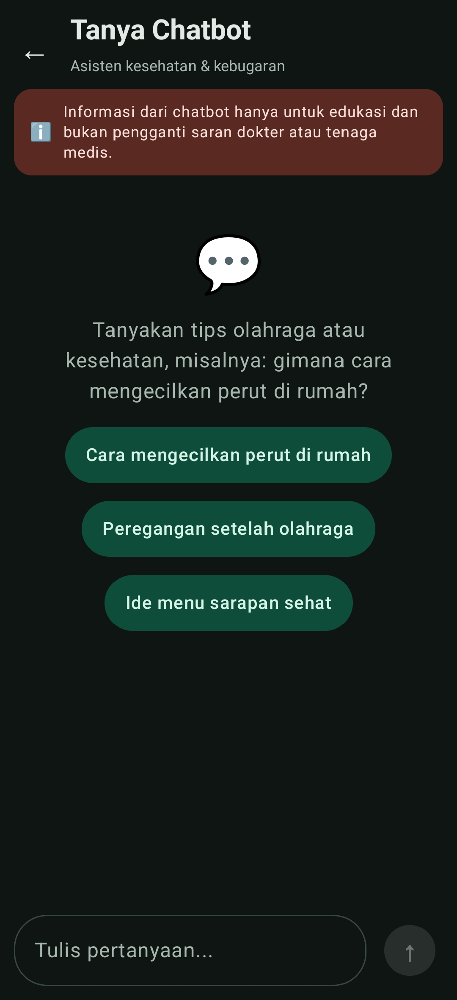

# **SelfCare Fitness**

`Daily Workout Tracker with a Health & Fitness Chatbot`

## 📌 Overview

SelfCare Fitness is an Android app that helps users build a consistent workout habit. Users can log their daily workout, track weekly progress, keep reminder notes, and ask health-related questions to a Gemini-powered chatbot.

All data is stored locally on the device using Room, so the app works without any account.

## 👨‍💻 Developed By

- `Ivan Roberto Halim`

## ⚙️ Features

- ✅ Daily workout logging with a checklist (Push-up, Sit-up, Plank, Squat, optional Jogging)
- 😴 "Skip today" option to mark a rest day
- 📅 7-day Weekly Report with a target of 5 workout days per week
- 🔄 Weekly data resets automatically every Monday
- ⏰ Workout reminders via the phone's built-in Clock app
- 📝 Reminder notes (add, edit, delete)
- 🤖 Health & fitness chatbot with a medical disclaimer
- 🌗 Automatic light and dark theme following the system

## 🧩 Core Modules

- `MainActivity` → Entry point, app theme, and Home ↔ Chat navigation
- `HomeScreen` → Daily status, weekly report, reminder, and notes
- `ChatScreen` → Chatbot conversation interface
- `HomeViewModel` → Daily status logic, weekly reset, and notes
- `ChatViewModel` → Conversation history and Gemini API calls
- `AlarmHelper` → Opens the Clock app to create an alarm
- `AppDatabase` → Room database (`day_records` and `notes`)

## 🛠️ Tech Stack

- 💻 Mobile Development: `Kotlin (Android)`
- 🎨 UI: `Jetpack Compose + Material 3`
- 🗄️ Database: `Room`
- 🌐 Networking: `Retrofit + OkHttp + Gson`
- 🤖 AI: `Google Gemini API`
- 🏗️ Architecture: `MVVM (ViewModel + StateFlow)`

## 🧠 How It Works

1. When the app opens, the date is refreshed and records before this week's Monday are deleted
2. The user taps **"Sudah kok!"** and checks every required exercise in the checklist, or taps **"Besok saja!"** to skip the day
3. Today's status appears in the Weekly Report (green = done, red = skipped)
4. Weekly progress is counted from completed days, and the target is reached at 5/5
5. In **Tanya Chatbot**, questions are sent to Gemini, which only answers health and fitness topics and politely refuses everything else

## 📸 Project Showcase

  
  

- Homepage
- Chatbot UI

## 📄 Notes

Information from the chatbot is for educational purposes only and is not a substitute for advice from a doctor or medical professional.
